# ERPNext v15 Master Orchestrator Skill (Cross-Functional Integration)

## 1. The Multi-Module Orchestration Philosophy
In ERPNext v15, no module operates in a silo. A business transaction initiates in one module and cascades through financial, inventory, operational, and permission layers. 

As an AI Agent, your role when this skill is invoked is to:
1. **Identify the Business Macro-Cycle**: Determine which End-to-End (E2E) workflow is being requested.
2. **Determine the Dependency Graph**: Ensure prerequisite documents exist and are in the required state (`docstatus=1`) before triggering downstream transactions.
3. **Dispatch to Sub-Skills**: Utilize the specialized module skills (`erpnext-selling`, `erpnext-stock`, `erpnext-accounting`, etc.) for domain-level validations.
4. **Maintain Referential Integrity**: Ensure primary keys (`Customer`, `Supplier`, `Item_code`, `Warehouse`, `Cost_Center`, `Project`) propagate accurately across transitions.

---

## 2. Global Macro-Cycles (End-to-End Business Workflows)

```mermaid
flowchart TD
    subgraph Lead_to_Cash ["1. Lead-to-Cash Cycle"]
        L[Lead - CRM] --> O[Opportunity - CRM]
        O --> Q[Quotation - Selling]
        Q --> SO[Sales Order - Selling]
        SO --> DN[Delivery Note - Stock]
        DN --> SI[Sales Invoice - Accounting]
        SI --> PE[Payment Entry - Accounting]
    end

    subgraph Procure_to_Pay ["2. Procure-to-Pay Cycle"]
        MR[Material Request - Stock] --> RFQ[Supplier Quotation - Buying]
        RFQ --> PO[Purchase Order - Buying]
        PO --> PR[Purchase Receipt - Stock]
        PR --> QI[Quality Inspection - Quality]
        QI --> PI[Purchase Invoice - Accounting]
        PI --> PPE[Payment Entry - Accounting]
    end

    subgraph Plan_to_Produce ["3. Plan-to-Produce Cycle"]
        SO2[Sales Order] --> PP[Production Plan - Mfg]
        PP --> WO[Work Order - Mfg]
        WO --> JC[Job Cards - Mfg]
        JC --> SE[Stock Entry: Manufacture - Stock]
        SE --> FG[Finished Goods in Warehouse]
    end

    subgraph Service_Project_Billing ["4. Project-to-Billing Cycle"]
        SO3[Sales Order] --> PROJ[Project - Projects]
        PROJ --> TSK[Tasks - Projects]
        TSK --> TS[Timesheets - Projects]
        TS --> SI2[Sales Invoice - Accounting]
    end
```

---

## 3. Cross-Module Linking Rules & Frappe RPC Methods

ERPNext provides built-in Python mapper functions to convert upstream documents into downstream documents while preserving references. When executing multi-step flows, invoke these standard mapper methods via REST RPC:

### A. Selling to Stock & Accounting
- **Quotation -> Sales Order**:
  `frappe.model.mapper.make_sales_order(source_name)`
- **Sales Order -> Delivery Note**:
  `erpnext.selling.doctype.sales_order.sales_order.make_delivery_note(source_name)`
- **Sales Order -> Sales Invoice**:
  `erpnext.selling.doctype.sales_order.sales_order.make_sales_invoice(source_name)`
- **Sales Invoice -> Payment Entry**:
  `erpnext.accounts.doctype.payment_entry.payment_entry.get_payment_entry(dt="Sales Invoice", dn=source_name)`

### B. Buying to Stock & Accounting
- **Material Request -> Purchase Order**:
  `erpnext.stock.doctype.material_request.material_request.make_purchase_order(source_name)`
- **Purchase Order -> Purchase Receipt**:
  `erpnext.buying.doctype.purchase_order.purchase_order.make_purchase_receipt(source_name)`
- **Purchase Order -> Purchase Invoice**:
  `erpnext.buying.doctype.purchase_order.purchase_order.make_purchase_invoice(source_name)`

### C. Projects & Services
- **Project / Task -> Timesheet**:
  Timesheets reference `parent_project` and `task`.
- **Timesheet -> Sales Invoice**:
  `erpnext.projects.doctype.timesheet.timesheet.make_sales_invoice(source_name)`

---

## 4. The 18-Module Responsibility Matrix

| Module | Core Responsibility in the Enterprise | Upstream Dependencies | Downstream Consumers |
|---|---|---|---|
| **1. Home** | Navigation, KPI Dashboards, Onboarding state | All modules | End users & executives |
| **2. Accounting** | General Ledger, Cashflow, Invoices, Taxation | Selling, Buying, Stock, Assets | Financial Statements, Tax Authorities |
| **3. Buying** | Vendor management, Procurement, Supplier Quotations | Stock (Material Requests) | Stock (Receipts), Accounting (Payables) |
| **4. Selling** | Quotes, Sales Orders, Pricing Rules, Customer limits | CRM (Leads/Opportunities) | Stock, Manufacturing, Projects, Accounting |
| **5. Stock** | Inventory valuation (FIFO/Moving Avg), Warehouses | Buying, Manufacturing | Selling, Quality, Accounting (Perpetual Inventory) |
| **6. Assets** | Fixed Asset depreciation, repairs, scrap | Buying, Accounting | Accounting (Depreciation Journal Entries) |
| **7. Manufacturing** | BOM, Work Orders, Operations, Capacity Planning | Selling (Sales Orders), Stock (Raw Materials) | Stock (Finished Goods), Accounting (WIP Ledger) |
| **8. Quality** | Inspections, Criteria tolerances, corrective actions | Buying (Receipts), Manufacturing (Job Cards) | Stock (Accepted vs Rejected warehouse) |
| **9. Projects** | Project planning, Gantt, Milestones, Timesheets | Selling (Sales Orders) | Accounting (Billing), HR (Timesheet payroll) |
| **10. Support** | Customer ticketing, SLAs, warranty, maintenance | Selling (Customer/Warranty) | Quality (Root cause), Projects (Bug tasks) |
| **11. Users** | Identity, RBAC, Role Profiles, Document Sharing | HR / Admin | All modules (determines read/write/submit access) |
| **12. Website** | Public Portal, Product Catalog, Blogs, Web Forms | Selling (Item website specs), CRM | CRM (Leads from forms), Selling (E-commerce cart) |
| **13. CRM** | Funnel management, Lead capture, Communication log | Website, Marketing campaigns | Selling (Prospect conversion to Customer) |
| **14. Tools** | Personal productivity: ToDos, Calendar, Notes | All modules | Employees |
| **15. Settings** | Company currency, Fiscal Year, Naming Series, Defaults | Admin | All modules |
| **16. Integrations** | Webhooks, Slack, Google Calendar, OAuth | External APIs | Core business events |
| **17. ERPNext Integrations** | Payment Gateways (Stripe, PayPal), Shopify, Amazon | External marketplaces | Selling, Stock, Accounting |
| **18. Build** | Custom Fields, Client Scripts, Server Scripts, Workspaces | Developer / DevOps | All modules (extends behavior dynamically) |

---

## 5. Agent Decision Protocol for Multi-Module Requests

When an end-user gives a high-level command like:
> *"We just signed a contract with Acme Corp for 100 units of Product A with a 10% discount, to be delivered next week. Make sure we have the stock and bill them."*

The Agent must execute this multi-step plan:
1. **Module 13 (CRM) / Module 4 (Selling)**: Check if `Customer: Acme Corp` exists. If not, create from Lead or directly.
2. **Module 4 (Selling)**: Create `Sales Order` with 100 units, 10% discount, and expected delivery date. Submit it (`docstatus=1`).
3. **Module 5 (Stock)**: Query `Bin` or `Stock Ledger` for projected qty of `Product A`.
   - If stock is sufficient: Prepare `Delivery Note`.
   - If stock is insufficient: Trigger **Module 3 (Buying)** for `Material Request` or **Module 7 (Manufacturing)** for `Production Plan`.
4. **Module 2 (Accounting)**: Generate `Sales Invoice` against the Sales Order.
5. **Module 14 (Tools)**: Create a `ToDo` or Calendar `Event` for the logistics manager to dispatch next week.
6. Provide a concise analytical report to the user summarizing all created document IDs and ledger impacts.
