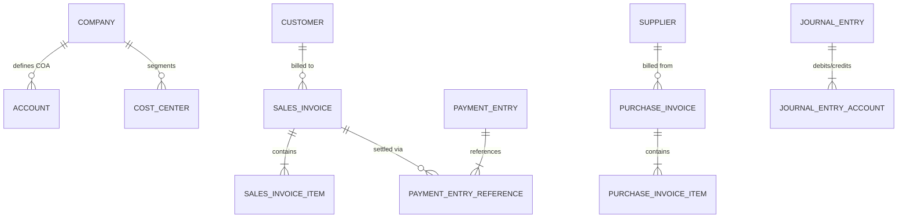

# ERPNext v15 Accounting Module Skill

## 1. Accounting Domain Architecture in ERPNext v15
ERPNext implements a standard multi-currency double-entry bookkeeping system with perpetual or periodic inventory valuation.

### Key Concepts
- **Chart of Accounts (COA)**: Root types are `Asset`, `Liability`, `Equity`, `Income`, and `Expense`. Accounts can be Groups (cannot have transactions) or Ledgers (leaf nodes that receive debits/credits).
- **Submittable Invoices & Entries**:
  - `Sales Invoice`: Debits Customer Receivable (Asset), credits Sales Income, credits Taxes Payable.
  - `Purchase Invoice`: Credits Supplier Payable (Liability), debits Expense or Stock In Hand, debits Tax Recoverable.
  - `Payment Entry`: Liquidates outstanding receivables/payables against Bank or Cash accounts.
  - `Journal Entry`: General ledger adjustments, inter-account transfers, depreciation, opening balances.
- **Cost Center & Dimensions**: Used for segmented financial reporting (e.g., project, department, region).

---

## 2. Core DocTypes & Relational Model



| DocType | Submittable? | Mandatory Fields | Common Filtering & Lookup Keys |
|---|---|---|---|
| `Sales Invoice` | Yes (`docstatus=1`) | `customer`, `company`, `posting_date`, `items` (`item_code`, `qty`, `rate`, `income_account`) | `status`, `customer`, `outstanding_amount`, `posting_date` |
| `Purchase Invoice` | Yes (`docstatus=1`) | `supplier`, `company`, `posting_date`, `items` (`item_code`, `qty`, `rate`, `expense_account`) | `status`, `supplier`, `outstanding_amount`, `bill_no` |
| `Payment Entry` | Yes (`docstatus=1`) | `payment_type` (`Receive`/`Pay`), `party_type`, `party`, `paid_from`, `paid_to`, `paid_amount` | `party`, `posting_date`, `reference_no` |
| `Journal Entry` | Yes (`docstatus=1`) | `voucher_type`, `company`, `posting_date`, `accounts` (at least 2 entries, Debit == Credit) | `voucher_type`, `posting_date`, `user_remark` |
| `Account` | No | `account_name`, `parent_account`, `company`, `root_type` | `is_group`, `root_type`, `account_type` |

---

## 3. Executive API Operations (Frappe REST API v15)

### A. Creating and Submitting a Sales Invoice
```python
# Payload structure for Sales Invoice
payload = {
    "doctype": "Sales Invoice",
    "customer": "Acme Corp",
    "company": "Your Company",
    "posting_date": "2026-10-23",
    "due_date": "2026-11-23",
    "currency": "USD",
    "items": [
        {
            "item_code": "CONSULTING-01",
            "qty": 10,
            "rate": 150.00,
            "income_account": "Sales - YC",
            "cost_center": "Main - YC"
        }
    ],
    "taxes": [
        {
            "charge_type": "On Net Total",
            "account_head": "VAT 15% - YC",
            "rate": 15.0,
            "description": "Standard VAT 15%"
        }
    ]
}
# Step 1: POST to create Draft (docstatus=0)
# Step 2: call_method("frappe.client.submit", doc={"doctype": "Sales Invoice", "name": invoice_name})
```

### B. Creating a Payment Entry against a Sales Invoice
```python
payment_payload = {
    "doctype": "Payment Entry",
    "payment_type": "Receive",
    "party_type": "Customer",
    "party": "Acme Corp",
    "company": "Your Company",
    "paid_from": "Debtors - YC",
    "paid_to": "Bank Account - YC",
    "paid_amount": 1725.00,
    "received_amount": 1725.00,
    "reference_no": "CHEQUE-99882",
    "reference_date": "2026-10-23",
    "references": [
        {
            "reference_doctype": "Sales Invoice",
            "reference_name": "ACC-SINV-2026-00001",
            "allocated_amount": 1725.00
        }
    ]
}
```

### C. Creating a Balanced Journal Entry
```python
journal_payload = {
    "doctype": "Journal Entry",
    "voucher_type": "Journal Entry",
    "company": "Your Company",
    "posting_date": "2026-10-23",
    "accounts": [
        {
            "account": "Office Supplies Expense - YC",
            "debit_in_account_currency": 500.00,
            "credit_in_account_currency": 0.00,
            "cost_center": "Main - YC"
        },
        {
            "account": "Cash - YC",
            "debit_in_account_currency": 0.00,
            "credit_in_account_currency": 500.00
        }
    ],
    "user_remark": "Stationery supplies purchase cash settlement"
}
```

---

## 4. Analytical & Advisory Recipes

### Receivables Aging & Outstanding Analysis
- Query: Filter `Sales Invoice` where `status in ("Unpaid", "Overdue")` and `outstanding_amount > 0`.
- Calculate DSI (Days Sales Outstanding) = `(Outstanding Debtors / Total Credit Sales) * Period Days`.
- Identify overdue clients and recommend credit freeze if aging > 90 days.

### Audit & Compliance Rules
1. **Total Debit == Total Credit**: Journal entries must be balanced down to the currency precision limit.
2. **Posting Date Validation**: The posting date cannot fall within a closed `Period Closing Voucher` or prior to `Frozen Accounts Date` in Account Settings.
3. **Mandatory Cost Centers**: If the account is an Income or Expense account, ensure a `Cost Center` is attached for P&L tracking.
