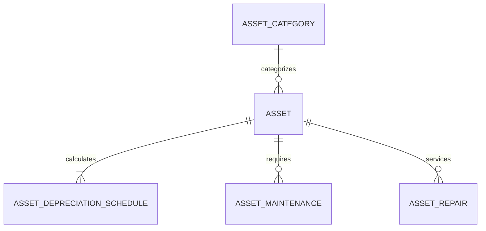

# ERPNext v15 Assets Module Skill

## 1. Domain Architecture & Business Logic
The Assets module tracks capital expenditures (CapEx), physical equipment locations, custodian assignments, and automated depreciation journal entries over the asset useful life.

### Key Concepts
- **Asset**: Physical capital item (machinery, computers, vehicles, furniture). Can be created from a `Purchase Receipt` or `Purchase Invoice`.
- **Asset Category**: Governs the accounting heads: Fixed Asset Account, Accumulated Depreciation Account, and Depreciation Expense Account.
- **Depreciation Schedule**: Auto-calculates periodic depreciation entries (Straight Line or Written Down Value / Double Declining).
- **Asset Maintenance & Repair**: Schedules preventative servicing and logs overhaul expenses (which can be capitalized into the asset value).

---

## 2. Core DocTypes & Relational Model



| DocType | Submittable? | Mandatory Fields | Common Filtering Keys |
|---|---|---|---|
| `Asset` | Yes (`docstatus=1`) | `asset_name`, `item_code`, `asset_category`, `company`, `gross_purchase_amount` | `status`, `asset_category`, `location`, `custodian` |
| `Asset Category` | No | `asset_category_name`, `accounts` | `asset_category_name` |
| `Asset Repair` | Yes (`docstatus=1`) | `asset`, `repair_status`, `company` | `asset`, `repair_status`, `completion_date` |
| `Asset Maintenance` | No | `asset_name`, `maintenance_manager` | `asset_name`, `maintenance_team` |

---

## 3. Executive API Operations (Frappe REST API v15)

### A. Creating and Submitting a Fixed Asset
```python
asset_payload = {
    "doctype": "Asset",
    "asset_name": "High-Precision CNC Milling Machine",
    "item_code": "MACH-CNC-2026",
    "asset_category": "Plant & Machinery",
    "company": "Your Company",
    "purchase_date": "2026-10-01",
    "gross_purchase_amount": 120000.00,
    "location": "Factory Floor - Bay 2",
    "calculate_depreciation": 1,
    "finance_books": [
        {
            "depreciation_method": "Straight Line",
            "total_number_of_depreciations": 60,
            "frequency_of_depreciation": 1,
            "expected_value_after_useful_life": 5000.00
        }
    ]
}
```

### B. Triggering Asset Scrapping or Disposal via RPC
```python
# To scrap an asset upon obsolescence or damage:
frappe_client.call_method(
    "erpnext.assets.doctype.asset.asset.make_journal_entry_for_scrap",
    asset_name="ACC-ASS-2026-00004"
)
```

---

## 4. Analytical & Advisory Recipes

### Net Book Value (NBV) & Impairment Monitoring
- **Net Book Value (NBV)**: `Gross Purchase Amount - Accumulated Depreciation`.
- **Maintenance Cost Ratio**: `(Total Repair & Maintenance Expenses / Gross Purchase Amount) * 100`. If > 40%, advise management to evaluate asset replacement instead of continued repairs.
- **Depreciation Run Verification**: Check for unposted depreciation entries past their scheduled booking date.
