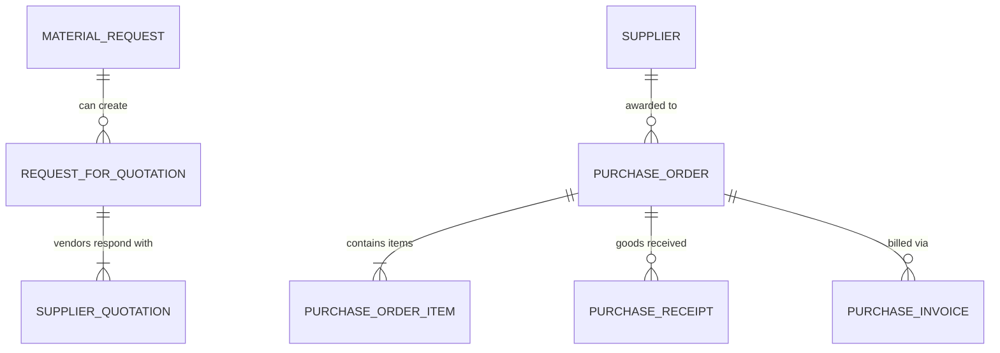

# ERPNext v15 Buying Module Skill

## 1. Domain Architecture & Business Logic
The Buying module governs the supplier sourcing and procurement lifecycle, ensuring materials, services, and inventory are acquired at optimal pricing, terms, and delivery schedules.

### Key Concepts
- **Supplier & Supplier Group**: Vendor classification, default currency, payment terms, and withholding tax categories.
- **Material Request (MR)**: Internal requisition originated from Stock low-levels, Sales Order drop-shipping, or Manufacturing Work Orders. Types: `Purchase`, `Material Transfer`, `Material Issue`, `Manufacture`, `Customer Provided`.
- **Request for Quotation (RFQ) & Supplier Quotation**: Competitive bidding mechanism to gather rates from multiple vendors.
- **Purchase Order (PO)**: Binding commitment sent to the supplier.
  - Controls receipt through `Purchase Receipt` and billing through `Purchase Invoice`.

---

## 2. Core DocTypes & Relational Model



| DocType | Submittable? | Mandatory Fields | Common Filtering Keys |
|---|---|---|---|
| `Supplier` | No | `supplier_name`, `supplier_group`, `supplier_type` (`Company`/`Individual`) | `supplier_name`, `supplier_group`, `disabled` |
| `Material Request` | Yes (`docstatus=1`) | `material_request_type`, `schedule_date`, `items` (`item_code`, `qty`, `schedule_date`) | `status`, `material_request_type`, `company` |
| `Purchase Order` | Yes (`docstatus=1`) | `supplier`, `company`, `transaction_date`, `schedule_date`, `items` (`item_code`, `qty`, `rate`, `schedule_date`) | `status`, `supplier`, `per_received`, `per_billed` |
| `Supplier Quotation` | Yes (`docstatus=1`) | `supplier`, `company`, `transaction_date`, `items` (`item_code`, `qty`, `rate`) | `supplier`, `status`, `valid_till` |

---

## 3. Executive API Operations (Frappe REST API v15)

### A. Creating and Submitting a Purchase Order
```python
purchase_order_payload = {
    "doctype": "Purchase Order",
    "supplier": "Premier Chipset Supplier",
    "company": "Your Company",
    "transaction_date": "2026-10-23",
    "schedule_date": "2026-11-15",
    "items": [
        {
            "item_code": "CHIP-V15-OCTA",
            "qty": 500,
            "rate": 45.00,
            "warehouse": "Stores - YC",
            "schedule_date": "2026-11-15"
        }
    ],
    "taxes_and_charges": "Standard In-State VAT - YC"
}
```

### B. Converting Purchase Order to Purchase Receipt or Invoice via RPC
```python
# Create Purchase Receipt
receipt_doc = frappe_client.call_method(
    "erpnext.buying.doctype.purchase_order.purchase_order.make_purchase_receipt",
    source_name="PUR-ORD-2026-00045"
)

# Create Purchase Invoice
invoice_doc = frappe_client.call_method(
    "erpnext.buying.doctype.purchase_order.purchase_order.make_purchase_invoice",
    source_name="PUR-ORD-2026-00045"
)
```

---

## 4. Analytical & Advisory Recipes

### Vendor Performance & Cost Trends
- **Supplier On-Time Delivery Rate**: Ratio of Purchase Receipts received on or before `Purchase Order Item.schedule_date`.
- **Purchase Price Variance (PPV)**: Compare current `Purchase Order.rate` vs `Item.valuation_rate` or historical average to advise management of raw material cost inflation.
- **Unreceived Commitment**: Calculate total value of Purchase Orders where `per_received < 100` to forecast incoming warehouse load.
