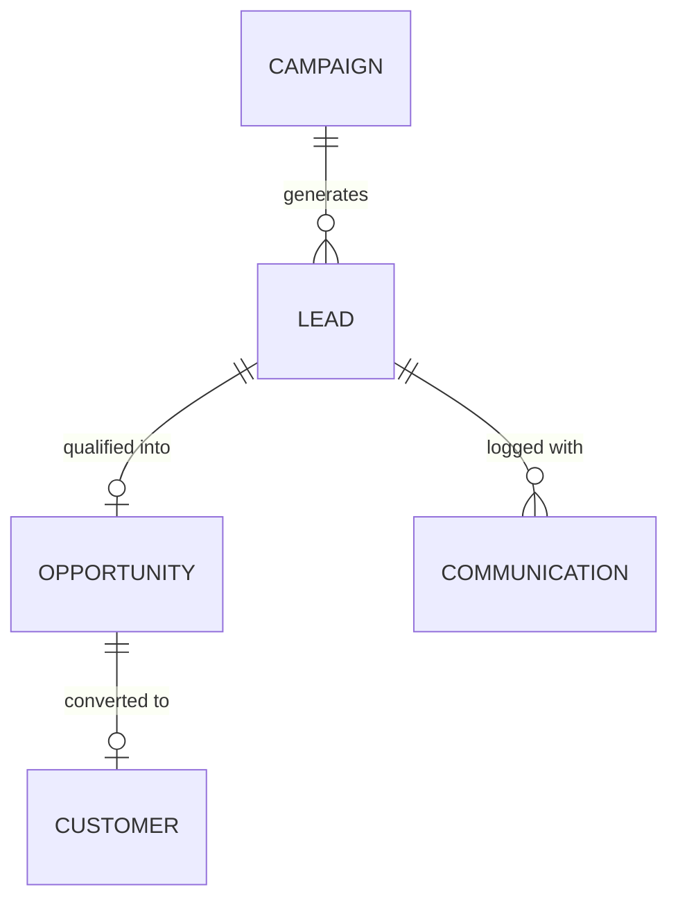

# ERPNext v15 CRM Module Skill

## 1. Domain Architecture & Business Logic
The CRM module organizes customer acquisition from initial marketing discovery down to qualified commercial interest ready for sales engagement.

### Key Concepts
- **Lead**: Potential prospect or individual with interest. Statuses: `Lead`, `Open`, `Replied`, `Opportunity`, `Quotation`, `Lost`, `Converted`.
- **Opportunity**: A qualified sales deal with an estimated deal value, probability percentage, and expected closing date.
- **Campaign**: Marketing initiative (Email, Social, Ads) to track source attribution and conversion rates.
- **Conversion Flow**:
  - `Lead` -> `Opportunity` -> `Quotation` -> `Customer`.

---

## 2. Core DocTypes & Relational Model



| DocType | Submittable? | Mandatory Fields | Common Filtering Keys |
|---|---|---|---|
| `Lead` | No | `lead_name`, `status` | `status`, `lead_owner`, `source`, `campaign_name` |
| `Opportunity` | No | `opportunity_from` (`Lead`/`Customer`), `party_name`, `opportunity_type`, `status` | `status`, `sales_stage`, `opportunity_owner`, `expected_closing` |
| `Campaign` | No | `campaign_name` | `campaign_name` |

---

## 3. Executive API Operations (Frappe REST API v15)

### A. Creating a New Lead
```python
lead_payload = {
    "doctype": "Lead",
    "lead_name": "Dr. Sarah Mitchell",
    "email_id": "sarah.m@healthtech.org",
    "mobile_no": "+1-555-0199",
    "company_name": "HealthTech Systems",
    "source": "Web Form",
    "status": "Lead"
}
```

### B. Creating an Opportunity from a Lead
```python
opportunity_payload = {
    "doctype": "Opportunity",
    "opportunity_from": "Lead",
    "party_name": "LEAD-2026-00034",
    "opportunity_type": "Sales",
    "opportunity_amount": 75000.00,
    "currency": "USD",
    "probability": 60,
    "expected_closing": "2026-11-30",
    "sales_stage": "Proposal/Price Quote"
}
```

---

## 4. Analytical & Advisory Recipes

### Funnel Velocity & Conversion Rate
- **Lead-to-Deal Conversion**: `(Count of converted Leads / Total New Leads in Period) * 100`.
- **Pipeline Value by Stage**: Aggregate sum of `opportunity_amount * (probability / 100)` grouped by `sales_stage`.
- **Stale Lead Notification**: Identify Leads with no `Communication` or status update within 14 days and prompt the sales owner.
