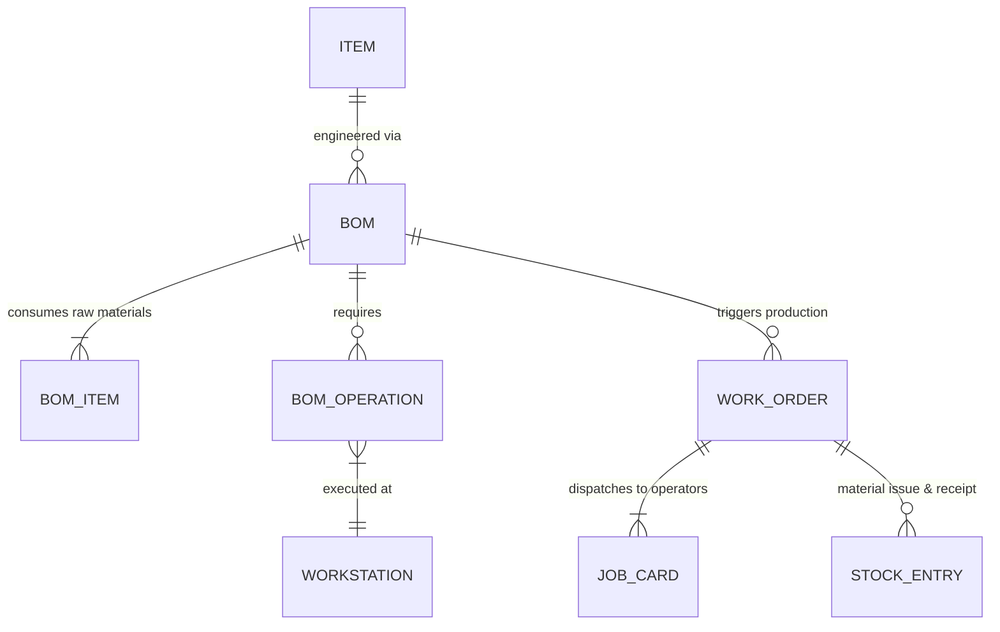

# ERPNext v15 Manufacturing Module Skill

## 1. Domain Architecture & Business Logic
The Manufacturing module coordinates the multi-stage conversion of raw materials into finished assemblies, scheduling machines/workstations, recording scrap, and computing accurate production cost.

### Key Concepts
- **Bill of Materials (BOM)**: The engineering blueprint detailing raw material items, quantities, scrap factor, sub-assemblies, and operational steps. Must be submitted (`is_active=1`, `is_default=1`).
- **Workstation & Operation**: Workstation represents machine or physical bench (with hourly operating/power cost). Operation represents the process (Cutting, Welding, Testing).
- **Routing**: Sequence of operations attached to a BOM.
- **Work Order (WO)**: The production trigger specifying target quantity and finish warehouse.
  - Generates **Job Cards** for machine operators.
  - Consumes raw materials (`Stock Entry: Material Transfer for Manufacture`).
  - Produces finished goods (`Stock Entry: Manufacture`).
- **Production Plan**: Aggregates open Sales Orders and material forecasts to batch-create Work Orders and Material Requests.

---

## 2. Core DocTypes & Relational Model



| DocType | Submittable? | Mandatory Fields | Common Filtering Keys |
|---|---|---|---|
| `BOM` | Yes (`docstatus=1`) | `item`, `quantity`, `items` (`item_code`, `qty`, `uom`) | `item`, `is_active`, `is_default` |
| `Work Order` | Yes (`docstatus=1`) | `production_item`, `bom_no`, `qty`, `wip_warehouse`, `fg_warehouse`, `company` | `status`, `production_item`, `sales_order` |
| `Job Card` | Yes (`docstatus=1`) | `work_order`, `operation`, `for_quantity`, `workstation` | `status`, `employee`, `work_order` |
| `Production Plan` | Yes (`docstatus=1`) | `company`, `get_items_from` | `status`, `posting_date` |

---

## 3. Executive API Operations (Frappe REST API v15)

### A. Creating and Submitting a Bill of Materials (BOM)
```python
bom_payload = {
    "doctype": "BOM",
    "item": "DESK-STAND-WOOD",
    "quantity": 1.0,
    "currency": "USD",
    "is_active": 1,
    "is_default": 1,
    "items": [
        {"item_code": "OAK-PLANK-1M", "qty": 2.0, "uom": "Nos"},
        {"item_code": "STEEL-BRACKET", "qty": 4.0, "uom": "Nos"},
        {"item_code": "SCREW-M5", "qty": 16.0, "uom": "Nos"}
    ],
    "with_operations": 1,
    "operations": [
        {"operation": "Wood Cutting & Sanding", "workstation": "Carpentry Bench 1", "time_in_mins": 30.0},
        {"operation": "Assembly & Finishing", "workstation": "Assembly Bay A", "time_in_mins": 20.0}
    ]
}
```

### B. Creating a Work Order from Sales Order
```python
work_order_payload = {
    "doctype": "Work Order",
    "production_item": "DESK-STAND-WOOD",
    "bom_no": "BOM-DESK-STAND-WOOD-001",
    "qty": 50,
    "wip_warehouse": "Work In Progress - YC",
    "fg_warehouse": "Finished Goods - YC",
    "company": "Your Company",
    "planned_start_date": "2026-11-01 08:00:00"
}
```

---

## 4. Analytical & Advisory Recipes

### Capacity Planning & Production Variance
- **Overall Equipment Effectiveness (OEE)**: Evaluates workstation uptime vs scheduled hours from `Job Card.time_logs`.
- **BOM Cost Drift**: Compare total BOM estimated cost vs actual `Stock Entry: Manufacture` unit valuation. Alert production engineers if cost variance > 5%.
- **Material Shortage Check**: Query `Bin` to verify if required raw material items for open Work Orders are fully available before releasing Job Cards.
