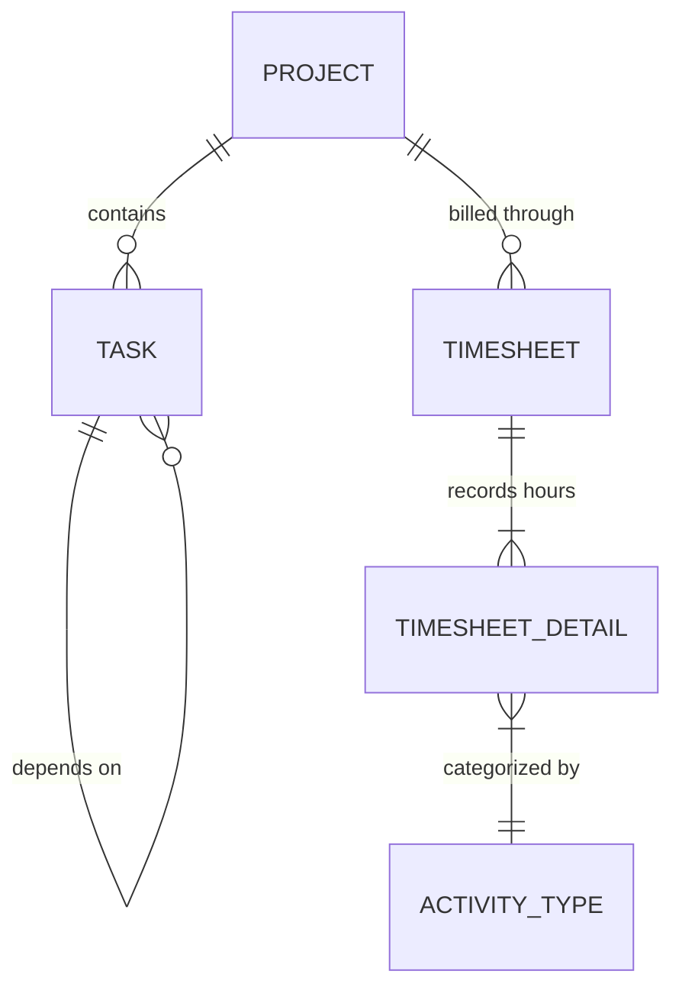

# ERPNext v15 Projects Module Skill

## 1. Domain Architecture & Business Logic
The Projects module manages deliverables, resource scheduling, task dependency trees, employee time tracking, and cost accounting against budgets.

### Key Concepts
- **Project**: Root container for budgets, dates, milestones, and costing. Can be linked to a `Customer` and `Sales Order`.
- **Task**: Granular unit of work assigned to employees with `exp_start_date`, `exp_end_date`, `priority`, and predecessor dependencies (`depends_on`).
- **Timesheet**: Tracks actual hours spent by employees by `Activity Type` against Tasks and Projects. Can be marked as `billable` to generate Sales Invoices automatically.
- **Project Costing**: Accumulates actual cost from:
  - Timesheet billable/costing rates
  - Purchase Invoices tagged with `Project`
  - Stock Entries issued to `Project`

---

## 2. Core DocTypes & Relational Model



| DocType | Submittable? | Mandatory Fields | Common Filtering Keys |
|---|---|---|---|
| `Project` | No | `project_name`, `status`, `expected_start_date` | `status`, `customer`, `percent_complete`, `is_active` |
| `Task` | No | `subject`, `project` | `project`, `status`, `priority`, `exp_end_date` |
| `Timesheet` | Yes (`docstatus=1`) | `employee`, `time_logs` (`activity_type`, `from_time`, `hours`, `project`) | `employee`, `status`, `start_date`, `end_date` |
| `Activity Type` | No | `activity_type` | `activity_type`, `disabled` |

---

## 3. Executive API Operations (Frappe REST API v15)

### A. Creating a Project with Tasks
```python
project_payload = {
    "doctype": "Project",
    "project_name": "Cloud ERP Migration - Phase 1",
    "customer": "Apex Retailers",
    "status": "Open",
    "expected_start_date": "2026-11-01",
    "expected_end_date": "2026-12-15",
    "estimated_costing": 35000.00
}

task_payload = {
    "doctype": "Task",
    "subject": "Data Migration & Schema Validation",
    "project": "Cloud ERP Migration - Phase 1",
    "status": "Open",
    "priority": "High",
    "exp_start_date": "2026-11-05",
    "exp_end_date": "2026-11-12",
    "expected_time": 40.0
}
```

### B. Submitting an Employee Timesheet
```python
timesheet_payload = {
    "doctype": "Timesheet",
    "employee": "EMP-0014",
    "company": "Your Company",
    "time_logs": [
        {
            "activity_type": "Consulting",
            "project": "Cloud ERP Migration - Phase 1",
            "from_time": "2026-11-06 09:00:00",
            "to_time": "2026-11-06 17:00:00",
            "hours": 8.0,
            "billable": 1,
            "billing_rate": 150.0,
            "costing_rate": 80.0
        }
    ]
}
```

---

## 4. Analytical & Advisory Recipes

### Project Health & Margin Realization
- **Budget Variance**: `(Actual Cost / Total Estimated Cost) * 100`. If > 90% before 50% milestone completion, raise budget overrun alert.
- **Resource Utilization**: Aggregate total billable hours vs non-billable hours from `Timesheet Detail` grouped by `employee`.
- **Overdue Task Monitor**: Query `Task` where `status in ('Open', 'Working')` and `exp_end_date < CURRENT_DATE`.
