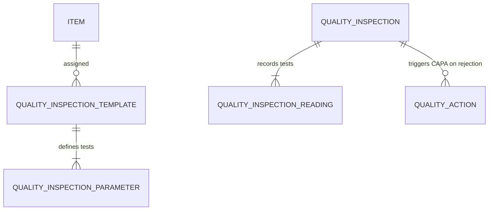

# ERPNext v15 Quality Module Skill

## 1. Domain Architecture & Business Logic
The Quality module guarantees that raw materials, manufacturing intermediates, and dispatched finished goods comply with precise engineering, safety, and regulatory tolerances.

### Key Concepts
- **Quality Inspection (QI)**: Mandatory physical or laboratory inspection record. Can be triggered at:
  - *Incoming*: During `Purchase Receipt` from supplier.
  - *In-Process*: During `Job Card` execution on the shop floor.
  - *Outgoing*: Prior to `Delivery Note` dispatch to customer.
- **Quality Inspection Parameter**: Defined test criteria (e.g., Tensile Strength, Dimensions, Moisture content, Purity) with minimum/maximum acceptance thresholds.
- **Quality Goal & Action (CAPA)**: Corrective and Preventive Action management following an ISO 9001 / Total Quality Management cycle.

---

## 2. Core DocTypes & Relational Model



| DocType | Submittable? | Mandatory Fields | Common Filtering Keys |
|---|---|---|---|
| `Quality Inspection` | Yes (`docstatus=1`) | `inspection_type`, `reference_type`, `reference_name`, `item_code`, `status` | `status`, `inspection_type`, `item_code`, `reference_name` |
| `Quality Inspection Parameter` | No | `parameter` | `parameter` |
| `Quality Goal` | No | `goal`, `frequency` | `status`, `frequency` |
| `Quality Action` | No | `document_type`, `document_name`, `action` | `status`, `resolution_date` |

---

## 3. Executive API Operations (Frappe REST API v15)

### A. Recording a Quality Inspection for Received Goods
```python
qi_payload = {
    "doctype": "Quality Inspection",
    "inspection_type": "Incoming",
    "reference_type": "Purchase Receipt",
    "reference_name": "MAT-PRE-2026-00018",
    "item_code": "CHIP-V15-OCTA",
    "sample_size": 25,
    "inspected_by": "john.inspector@company.com",
    "status": "Accepted",
    "readings": [
        {
            "specification": "Operating Voltage (V)",
            "min_value": 3.15,
            "max_value": 3.45,
            "reading_value": "3.30",
            "status": "Accepted"
        },
        {
            "specification": "Thermal Dissipation (W)",
            "min_value": 0.0,
            "max_value": 15.0,
            "reading_value": "12.4",
            "status": "Accepted"
        }
    ]
}
```

---

## 4. Analytical & Advisory Recipes

### Defect Rate & Supplier Quality Scoring
- **Lot Rejection Rate (LRR)**: `(Rejected Inspections / Total Inspections Performed) * 100`.
- **Supplier Quality Score**: Score vendors based on percentage of zero-defect Purchase Receipts. Flag suppliers with LRR > 3% for vendor audit.
- **Root Cause & CAPA Audit**: Track open `Quality Action` tickets unresolved past 30 days.
