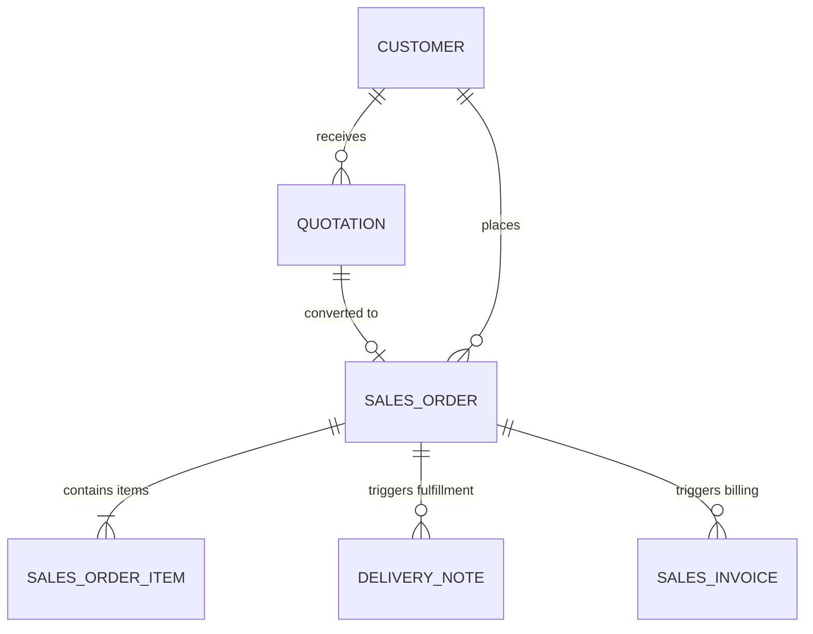

# ERPNext v15 Selling Module Skill

## 1. Domain Architecture & Business Logic
The Selling module governs the commercial order-taking and fulfillment pipeline from Customer agreement down to Delivery and Billing authorization.

### Key Concepts
- **Customer & Customer Group**: Classification of buyers, default tax templates, price lists, and payment terms.
- **Quotation**: Estimate submitted to Lead or Customer. Valid until `valid_till`. Does not impact financial or inventory ledgers.
- **Sales Order (SO)**: The central legally-binding operational commitment. 
  - Statuses: `Draft`, `To Deliver and Bill`, `To Bill`, `To Deliver`, `Completed`, `Cancelled`, `Closed`.
  - Serves as the origin for `Delivery Note`, `Sales Invoice`, `Material Request` (Drop Ship / Manufacture), or `Project`.
- **Pricing Rule & Item Price**: Dynamic pricing engine (promotions, volume discount, free items, margin).

---

## 2. Core DocTypes & Relational Hierarchy



| DocType | Submittable? | Mandatory Fields | Common Filtering Keys |
|---|---|---|---|
| `Customer` | No | `customer_name`, `customer_type` (`Company`/`Individual`), `customer_group`, `territory` | `customer_name`, `customer_group`, `territory`, `disabled` |
| `Quotation` | Yes (`docstatus=1`) | `quotation_to` (`Lead`/`Customer`), `party_name`, `company`, `transaction_date`, `items` | `status`, `party_name`, `valid_till` |
| `Sales Order` | Yes (`docstatus=1`) | `customer`, `company`, `transaction_date`, `delivery_date`, `items` (`item_code`, `qty`, `rate`, `delivery_date`) | `status`, `customer`, `delivery_status`, `billing_status` |
| `Pricing Rule` | No | `title`, `apply_on`, `price_or_product_discount`, `company` | `item_code`, `customer`, `valid_from`, `valid_upto` |

---

## 3. Executive API Operations (Frappe REST API v15)

### A. Creating and Submitting a Sales Order
```python
sales_order_payload = {
    "doctype": "Sales Order",
    "customer": "Global Trade LLC",
    "company": "Your Company",
    "transaction_date": "2026-10-23",
    "delivery_date": "2026-11-05",
    "order_type": "Sales",
    "items": [
        {
            "item_code": "LAPTOP-PRO-16",
            "qty": 5,
            "rate": 1800.00,
            "warehouse": "Finished Goods - YC",
            "delivery_date": "2026-11-05"
        }
    ],
    "payment_terms_template": "50-50 Split",
    "taxes_and_charges": "Standard VAT - YC"
}
```

### B. Converting a Quotation into a Sales Order via Frappe RPC
```python
# Execute whitelisted conversion mapper
sales_order_doc = frappe_client.call_method(
    "erpnext.selling.doctype.quotation.quotation.make_sales_order",
    source_name="SAL-QTN-2026-00012"
)
# Review/Adjust sales_order_doc, then create and submit
```

---

## 4. Analytical & Advisory Recipes

### Sales Pipeline & Conversion Analysis
- **Win-Rate Metric**: `(Count of Quotations converted to Sales Orders / Total Quotations Submitted) * 100`.
- **Fulfillment Backlog**: Query `Sales Order` where `status = 'To Deliver'` and `delivery_date < CURRENT_DATE` to alert logistics of delayed shipments.
- **Credit Limit Verification**: Verify customer's current total unbilled/unpaid balance against `Customer.credit_limit`. Warn the user if placing the order will exceed credit thresholds.
