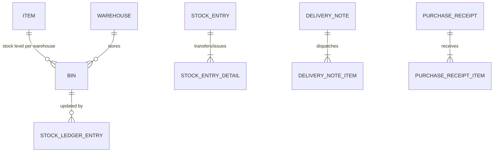

# ERPNext v15 Stock Module Skill

## 1. Domain Architecture & Business Logic
The Stock module manages physical goods tracking, multi-warehouse storage, serialization, batch expiration, and perpetual inventory valuation (FIFO or Moving Average).

### Key Concepts
- **Item**: Master for goods and services. Stock items have `is_stock_item=1`, maintaining balances in the `Bin` table per warehouse.
- **Warehouse**: Hierarchical tree of storage locations (e.g., Stores, Work In Progress, Finished Goods, Scrap).
- **Stock Ledger Entry (SLE)**: Immutable ledger records created upon submission of stock transactions (`docstatus=1`). Cannot be edited directly.
- **Stock Entry Types**:
  - `Material Issue`: Deducts stock (expense/scrap).
  - `Material Receipt`: Adds stock without supplier purchase (opening balance/gifts).
  - `Material Transfer`: Relocates stock from source warehouse to target warehouse.
  - `Manufacture`: Consumes raw materials and yields finished products.
- **Delivery Note & Purchase Receipt**: The physical fulfillment counterparts of Sales Orders and Purchase Orders.

---

## 2. Core DocTypes & Relational Model



| DocType | Submittable? | Mandatory Fields | Common Filtering Keys |
|---|---|---|---|
| `Item` | No | `item_code`, `item_group`, `stock_uom` | `item_code`, `item_group`, `is_stock_item`, `disabled` |
| `Warehouse` | No | `warehouse_name`, `company` | `warehouse_name`, `is_group`, `company` |
| `Stock Entry` | Yes (`docstatus=1`) | `stock_entry_type`, `company`, `items` (`item_code`, `qty`, `s_warehouse`/`t_warehouse`) | `stock_entry_type`, `posting_date`, `purpose` |
| `Delivery Note` | Yes (`docstatus=1`) | `customer`, `company`, `items` (`item_code`, `qty`, `warehouse`) | `customer`, `status`, `posting_date` |
| `Purchase Receipt` | Yes (`docstatus=1`) | `supplier`, `company`, `items` (`item_code`, `qty`, `warehouse`) | `supplier`, `status`, `posting_date` |
| `Stock Reconciliation`| Yes (`docstatus=1`)| `company`, `purpose`, `items` (`item_code`, `warehouse`, `qty`, `valuation_rate`) | `posting_date`, `purpose` |

---

## 3. Executive API Operations (Frappe REST API v15)

### A. Material Transfer between Warehouses
```python
transfer_payload = {
    "doctype": "Stock Entry",
    "stock_entry_type": "Material Transfer",
    "company": "Your Company",
    "posting_date": "2026-10-23",
    "items": [
        {
            "item_code": "RAW-ALUMINUM-INGOT",
            "qty": 100,
            "s_warehouse": "Stores - YC",
            "t_warehouse": "Work In Progress - YC"
        }
    ]
}
```

### B. Checking Actual Stock & Projected Quantity
```python
# Query the Bin table to find stock availability
bin_records = frappe_client.get_list(
    "Bin",
    filters=[
        ["item_code", "=", "RAW-ALUMINUM-INGOT"],
        ["warehouse", "=", "Stores - YC"]
    ],
    fields=["actual_qty", "reserved_qty", "ordered_qty", "projected_qty", "valuation_rate"]
)
```

---

## 4. Analytical & Advisory Recipes

### Inventory Turnover & Dead Stock Analysis
- **Days Sales of Inventory (DSI)**: `(Average Inventory Valuation / Cost of Goods Sold) * 365`.
- **Dead Stock Detector**: Query `Bin` where `actual_qty > 0` but no `Stock Ledger Entry` has occurred in the past 180 days. Advise management on clearance or scrap.
- **Stock Reorder Alerts**: If `Bin.projected_qty <= Item.reorder_level`, generate advisory to raise a `Material Request`.
