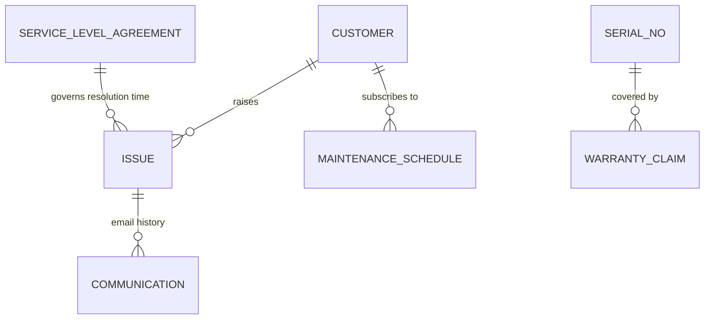

# ERPNext v15 Support Module Skill

## 1. Domain Architecture & Business Logic
The Support module provides end-to-end customer service and post-sale maintenance, enforcing response/resolution SLA compliance and tracking warranty commitments.

### Key Concepts
- **Issue**: Support ticket logged via email, web form, API, or customer portal.
  - Statuses: `Open`, `Replied`, `On Hold`, `Resolved`, `Closed`.
  - Priorities: `Low`, `Medium`, `High`, `Urgent`.
- **Service Level Agreement (SLA)**: Defines guaranteed first response time and total resolution time based on customer tier and issue priority.
- **Warranty Claim & Maintenance Schedule**: Manages serialized hardware warranty validity, technician site visits, and scheduled preventative maintenance.

---

## 2. Core DocTypes & Relational Model



| DocType | Submittable? | Mandatory Fields | Common Filtering Keys |
|---|---|---|---|
| `Issue` | No | `subject`, `status`, `raised_by` | `status`, `priority`, `customer`, `service_level_agreement`, `agreement_status` |
| `Service Level Agreement`| No | `service_level_agreement`, `default_service_level_agreement` | `service_level_agreement` |
| `Warranty Claim` | No | `customer`, `status`, `item_code` | `status`, `customer`, `serial_no` |
| `Maintenance Schedule` | Yes (`docstatus=1`) | `customer`, `items` (`item_code`, `start_date`, `end_date`, `periodicity`) | `customer`, `status` |

---

## 3. Executive API Operations (Frappe REST API v15)

### A. Logging a Customer Support Issue
```python
issue_payload = {
    "doctype": "Issue",
    "subject": "System downtime reported in Production Cluster",
    "customer": "Apex Retailers",
    "raised_by": "cto@apexretail.com",
    "priority": "Urgent",
    "issue_type": "Critical Bug",
    "description": "API Gateway returning 502 Bad Gateway starting 14:00 UTC."
}
```

### B. Resolving an Issue and Recording Resolution
```python
update_payload = {
    "status": "Resolved",
    "resolution_details": "Restarted upstream worker pool and refreshed SSL certificates.",
    "opening_date": "2026-10-23",
    "resolution_date": "2026-10-23 15:30:00"
}
# PUT to /api/resource/Issue/{issue_name}
```

---

## 4. Analytical & Advisory Recipes

### SLA Compliance & Helpdesk Metrics
- **First Response Time (FRT)**: Duration between `creation` and first outgoing `Communication`.
- **SLA Breach Rate**: Percentage of tickets where `agreement_status = 'Fulfilled'` vs `'Failed'`.
- **Recurring Issue Cluster**: Group issues by `item_code` or `issue_type` to detect hardware manufacturing defects or software regression bugs.
