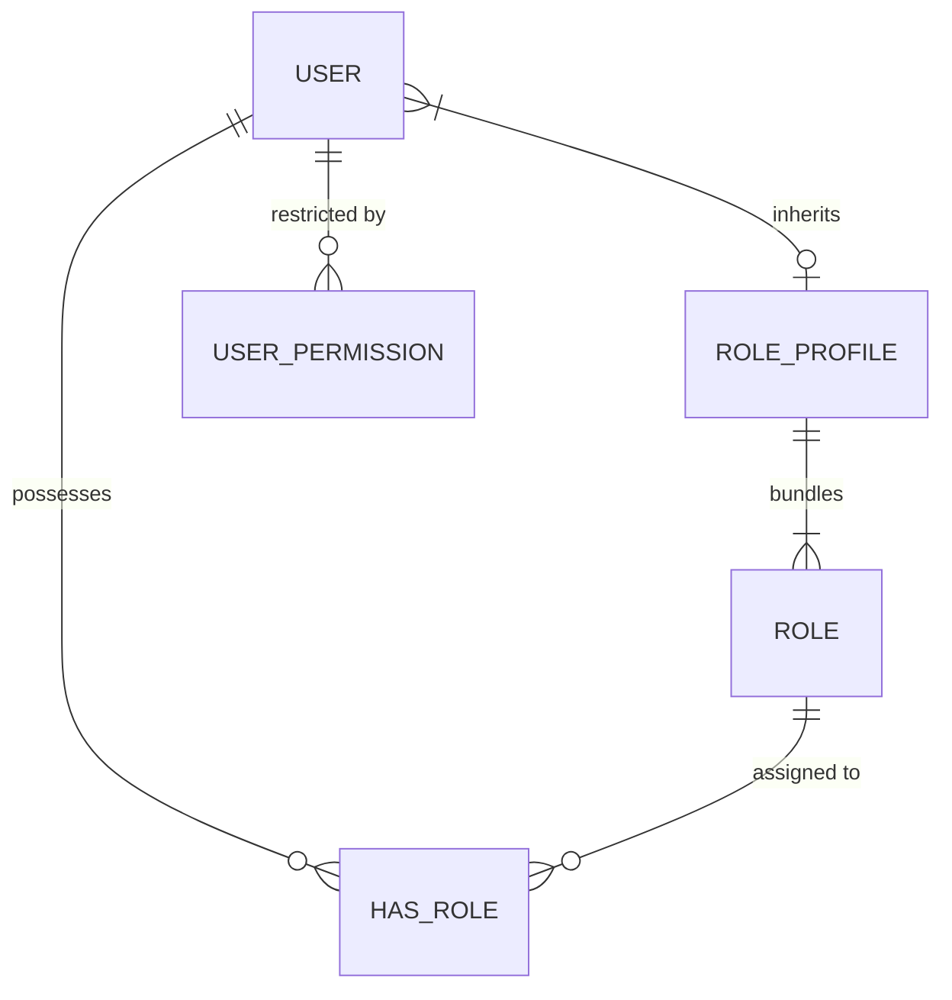

# ERPNext v15 Users & Permissions Skill

## 1. Domain Architecture & Business Logic
The Users module in Frappe/ERPNext v15 enforces a multi-tiered security model: Role-Based Access Control (RBAC), Permission Levels (field-level security), and User Permissions (row-level security).

### Key Concepts
- **User**: The identity master (`email`, `first_name`, `enabled`, `user_type`: `System User` vs `Website User`).
- **Role & Role Profile**:
  - `Role`: Functional job title/privilege (e.g., `Accounts Manager`, `Stock User`, `Sales Master Manager`).
  - `Role Profile`: Standardized bundle of Roles assigned to users to eliminate manual role drift.
- **Module Profile**: Restricts visible sidebar modules for targeted user focus.
- **Role Permissions Manager**: Grants `Read`, `Write`, `Create`, `Submit`, `Cancel`, `Amend`, `Delete`, `Print`, `Email`, `Export`, and `Share` rights per DocType and Role.
- **User Permissions (Row-Level Security)**: Restricts a user to only see documents linked to specific values (e.g., User can only view records for `Company = "Branch North"` or `Cost Center = "Marketing"`).

---

## 2. Core DocTypes & Relational Model



| DocType | Submittable? | Mandatory Fields | Common Filtering Keys |
|---|---|---|---|
| `User` | No | `email`, `first_name` | `enabled`, `user_type`, `role_profile_name` |
| `Role` | No | `role_name` | `role_name`, `disabled` |
| `Role Profile` | No | `role_profile` | `role_profile` |
| `User Permission` | No | `user`, `allow` (DocType), `for_value` (Record ID) | `user`, `allow`, `for_value` |

---

## 3. Executive API Operations (Frappe REST API v15)

### A. Provisioning a New User with Role Profile
```python
user_payload = {
    "doctype": "User",
    "email": "salman.finance@company.com",
    "first_name": "Salman",
    "last_name": "Al-Otaibi",
    "send_welcome_email": 1,
    "user_type": "System User",
    "role_profile_name": "Junior Accountant Profile",
    "roles": [
        {"role": "Accounts User"}
    ]
}
```

### B. Applying Row-Level User Permission
```python
user_perm_payload = {
    "doctype": "User Permission",
    "user": "salman.finance@company.com",
    "allow": "Company",
    "for_value": "Riyadh Branch LLC",
    "is_default": 1
}
```

---

## 4. Analytical & Advisory Recipes

### Security Audit & Privilege Creep Detection
- **Superuser Audit**: Query users possessing `System Manager` or `Administrator` privileges. Flag dormant accounts enabled past 60 days.
- **Permission Matrix Conflict**: Ensure conflicting roles (such as both `Purchase User` and `Purchase Approver`) are not assigned to the same user without compliance sign-off.
- **Row-Level Leak Check**: Verify that branch managers cannot view sibling branch records when user permissions are enforced.
