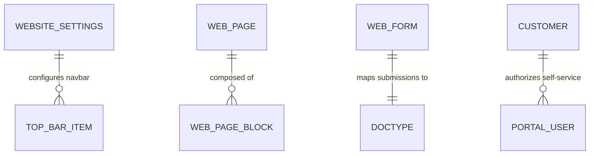

# ERPNext v15 Website Module Skill

## 1. Domain Architecture & Business Logic
The Website module turns ERPNext into an outward-facing digital touchpoint: publishing corporate websites, e-commerce storefronts, self-service customer/supplier portals, and public forms.

### Key Concepts
- **Web Page & Blog Post**: Content management system (CMS) with Markdown, HTML, and Jinja rendering.
- **Web Form**: Public or authenticated intake form mapped directly to any Frappe DocType (e.g., job applications to `Job Applicant`, vendor onboarding to `Supplier`, warranty requests to `Issue`).
- **Customer / Supplier Portal**: Allows authenticated portal users to view their Quotations, Invoices, Delivery status, and open tickets.
- **Website Settings & Theme**: Global branding, navbar links, footer menus, custom CSS/SCSS, and analytics scripts.

---

## 2. Core DocTypes & Relational Model



| DocType | Submittable? | Mandatory Fields | Common Filtering Keys |
|---|---|---|---|
| `Web Page` | No | `title`, `route` | `published`, `route` |
| `Blog Post` | No | `title`, `blog_category`, `blogger` | `published`, `blog_category` |
| `Web Form` | No | `title`, `route`, `doc_type` | `is_standard`, `published` |
| `Website Settings`| No | Single Document | Single |

---

## 3. Executive API Operations (Frappe REST API v15)

### A. Publishing a Product Announcement Web Page
```python
web_page_payload = {
    "doctype": "Web Page",
    "title": "Announcing Industrial Next-Gen Motors",
    "route": "products/nextgen-motors",
    "published": 1,
    "main_section_md": """
# Next-Gen Electric Industrial Motors
Engineered for 98% thermal efficiency and seamless IoT integration.
Contact our sales engineering team for technical datasheets.
    """
}
```

---

## 4. Analytical & Advisory Recipes

### Conversion & Engagement Tracking
- **Web Form Drop-Off**: Monitor inbound inquiries from `Web Form` vs created `Lead` conversion rates.
- **SEO Health**: Ensure `meta_title`, `meta_description`, and OpenGraph images are configured for all published pages.
- **Portal Self-Service Rate**: Percentage of invoices viewed or paid directly via portal without customer support intervention.
