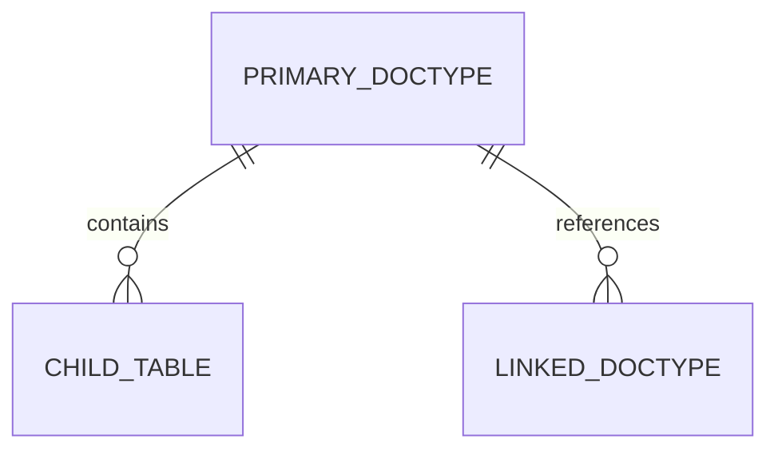

# ERPNext v15 - [Module Name] Module Skill

## 1. Domain Overview & Advisory Architecture
- **Module Purpose**: [Explain what this module solves in business operations]
- **Target Persona & Roles**: [e.g., Accounts User, Accounts Manager, Auditor]
- **Standard Frappe v15 Conventions**:
  - Submittable DocType lifecycle: `Draft (0)` -> `Submitted (1)` -> `Cancelled (2)` -> `Amended`
  - Currency & Decimal precision defaults
  - Company & Fiscal Year linkage

---

## 2. Core DocTypes & Relational Architecture


| DocType | Is Submittable? | Mandatory Fields | Common Filters / Keys |
|---|---|---|---|
| `[DocType Name]` | Yes / No | `field1`, `field2`, `company` | `status`, `posting_date` |

---

## 3. Executive API Operations (Frappe REST API v15)

### Authentication Protocol
All REST requests require Frappe Token headers:
`Authorization: token <api_key>:<api_secret>`

### Standard CRUD Operations
- **List / Query Records**:
  ```http
  GET /api/resource/[DocType]?filters=[["status","=","Draft"]]&fields=["name","creation","status"]&limit_page_length=20
  ```
- **Read Single Record**:
  ```http
  GET /api/resource/[DocType]/{name}
  ```
- **Create Document**:
  ```http
  POST /api/resource/[DocType]
  Content-Type: application/json
  
  {
    "company": "Your Company",
    "field1": "value"
  }
  ```
- **Submit Document (docstatus = 1)**:
  ```http
  POST /api/method/frappe.client.submit
  Content-Type: application/json

  {
    "doc": {
      "doctype": "[DocType]",
      "name": "DOC-00001"
    }
  }
  ```
- **Cancel Document (docstatus = 2)**:
  ```http
  POST /api/method/frappe.client.cancel
  Content-Type: application/json

  {
    "doctype": "[DocType]",
    "name": "DOC-00001"
  }
  ```

---

## 4. Analytical & Advisory Recipes
- **KPI Calculation Queries**:
  - How to compute key ratios or detect anomalies using ERPNext queries.
- **Audit & Compliance Checks**:
  - Validations to run before submission.
- **Troubleshooting Common Errors**:
  - *Error*: `frappe.exceptions.MandatoryError` -> Missing required fields.
  - *Error*: `frappe.exceptions.LinkValidationError` -> Referenced document does not exist.

---

## 5. Cross-Module Interaction Hand-offs
- Downstream triggers: When a document in this module reaches `Submitted`, what does it trigger in other modules?
- Upstream dependencies: What documents must exist prior to creating records in this module?
